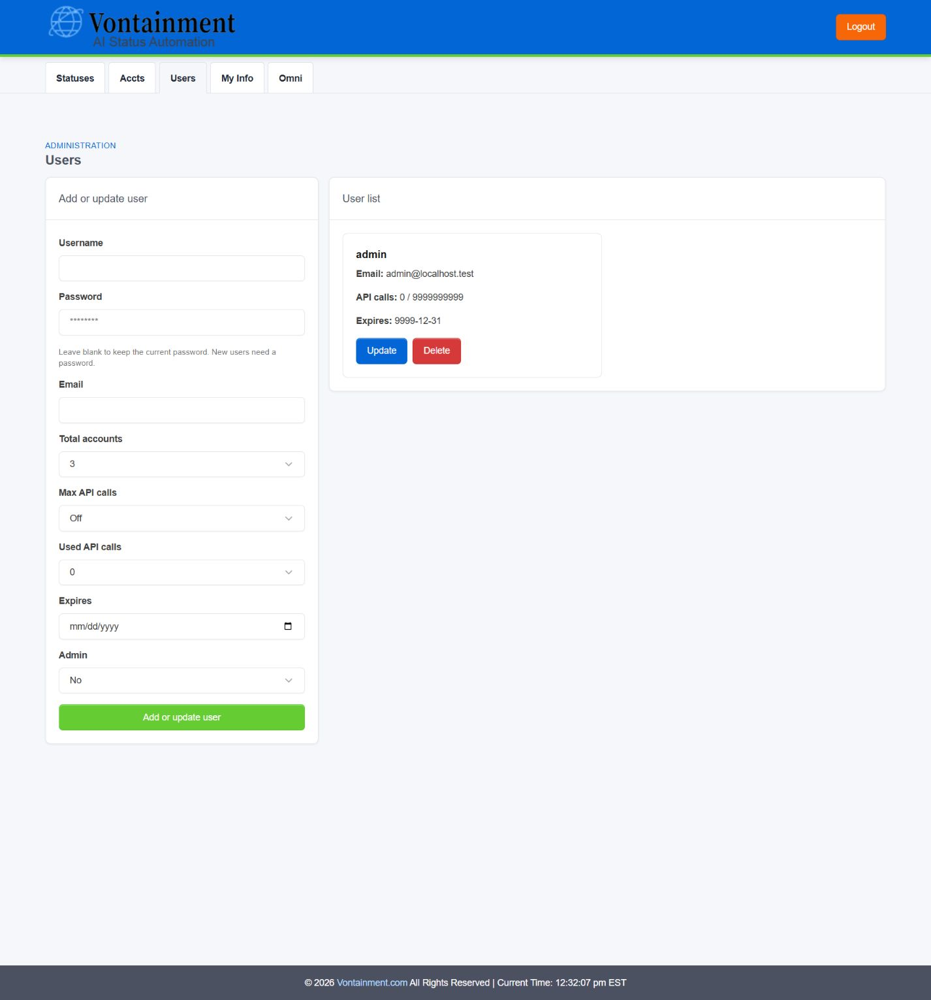

# V ChatGPT Social Status Feeds

> A PHP application for generating, scheduling, and publishing social media status updates through RSS feeds.


## Table of Contents

1. [Overview](#overview)
2. [Features](#features)
3. [Project Structure](#project-structure)
4. [Getting Started](#getting-started)
5. [Usage](#usage)
6. [Development](#development)
7. [Docker](#docker)
8. [Changelog](#changelog)
9. [License](#license)

## Overview

Social Status Feeds is a modular PHP application for managing social accounts, generating status content with OpenAI, scheduling posts, and publishing RSS feeds. The application uses an MVC structure with controllers, models, services, helpers, and views. Its front controller creates an HTTP request, dispatches it through the router, and sends the resulting response.

Application code and runtime dependencies live under `root/`. Repository-level Composer and npm manifests provide development tools and tests. The current configuration identifies the application as version 3.0.0 and uses PHP 8.2 or later.

## Features

| Area | Details |
| :--- | :--- |
| Application | MVC structure with request/response routing and centralized database access through Doctrine DBAL. |
| Status generation | Generates social status text and images through the configured OpenAI API and model settings. |
| Scheduling | Stores scheduled work in the `status_jobs` table and processes due jobs with cron workers. |
| RSS feeds | Publishes account feeds and a collective user feed for external services such as IFTTT. |
| Caching | Uses an in-memory cache and APCu when available, with configurable cache TTLs. |
| Security | Includes CSRF protection, input validation, hardened sessions, IP blacklisting, and escaped view output. |
| Dashboard | Provides account and user management, schedule controls, and accessible collapsible feed panels. |

## Project Structure

```text
v-chatgpt-social-status-feeds/
├── docker/                  # Docker image and Compose configuration
├── root/                    # Application and runtime Composer dependencies
│   ├── app/                 # Controllers, core classes, helpers, models, services, templates, and views
│   ├── public/              # Web root and public assets
│   ├── config.php           # Runtime configuration
│   ├── cron.php             # Queue and maintenance worker entry point
│   ├── install.sql          # Fresh-install schema
│   └── upgrade.sql          # Database migrations
├── tests/                   # PHPUnit tests
├── composer.json            # Development dependencies and PHP scripts
├── package.json             # JavaScript and CSS lint tools
├── CHANGELOG.md
└── README.md
```

## Getting Started

### Requirements

- PHP 8.2 or later
- Apache or another PHP-capable web server
- MySQL 8.0 or compatible MariaDB
- Composer and Node.js 26 or later for development checks
- APCu is optional; the application falls back to per-request in-memory caching

### Installation

1. Upload or clone the repository to your server and set `root/public/` as the web root.
2. Configure database credentials, the OpenAI API key, SMTP settings, and `DEFAULT_TIMEZONE` in `root/config.php`.
3. For a fresh database, visit `/install.php`. To migrate an existing database, back it up and visit `/upgrade.php`.
4. Sign in with the initial `admin` username and password, then change the password immediately.
5. Configure the cron entries below. Replace `/PATH-TO-APP/` with the full path to `root/`.

```cron
0 0 * * * /usr/bin/php /PATH-TO-APP/cron.php worker daily
5 0 * * * /usr/bin/php /PATH-TO-APP/cron.php worker fill-queue
*/10 * * * * /usr/bin/php /PATH-TO-APP/cron.php worker run-queue
0 0 1 * * /usr/bin/php /PATH-TO-APP/cron.php worker monthly
```

The `worker` form checks for an existing task before launch. For hosts that cannot spawn background processes, run a task directly, such as `php cron.php run-queue`. The queue worker processes due retries before pending jobs, retries a failed job once, and removes it after a second failure. Queue filling adds future schedule slots without deleting existing jobs. Set `CRON_DISABLE_WORKER_SPAWN` when the worker must run inline.

### Docker

From the repository root, build and start the application and database with:

```sh
docker compose -f docker/docker-compose.yml up --build
```

Review the Docker configuration and replace example API and database settings before deployment.

## Usage

### Users and profile

Sign in to the dashboard to create or update users. Use **My Info** to manage your profile.




### Social accounts

Add a social account with its platform, prompt, link, image instructions, scheduled days and times, and hashtag preference.


### Publishing and generation

Use the account feed or collective user feed with a compatible publishing service. Use **Generate Status** to queue an immediately due job. The next `run-queue` execution processes it; generation does not run in the web request.

The queue is stored in `status_jobs`. Its `status` field distinguishes first attempts (`pending`) from retries (`retry`). The `status_jobs` table includes `processing BOOLEAN NOT NULL DEFAULT FALSE`. The `processing` is flipped to `true` when a worker claims a job; it is cleared when work finishes or a stale claim is reset.

### Cache Configuration

Cache settings can be supplied through environment variables or `root/config.php` constants:

| Setting | Default | Purpose |
| :--- | :--- | :--- |
| `CACHE_ENABLED` | `true` | Enables caching. |
| `CACHE_TTL_USER` | `300` seconds | User data lifetime. |
| `CACHE_TTL_ACCOUNT` | `600` seconds | Account data lifetime. |
| `CACHE_TTL_STATUS` | `60` seconds | Status data lifetime. |
| `CACHE_TTL_FEED` | `180` seconds | Feed and image metadata lifetime. |

## Development

Install development dependencies from the repository root:

```sh
composer install
npm install
```

Available checks:

```sh
composer test
composer phpcs
composer phpstan
npm run lint
```

## Changelog

See [CHANGELOG.md](./CHANGELOG.md) for release history and current changes.

## License

This project is licensed under the [MIT License](./LICENSE).
